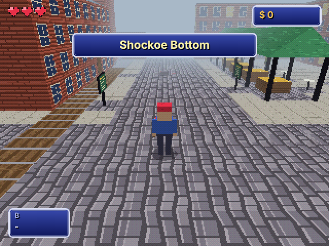
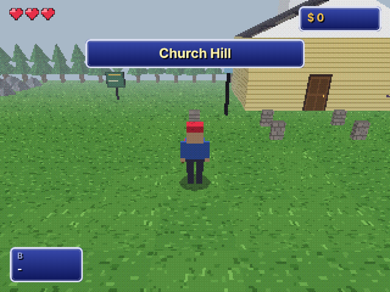
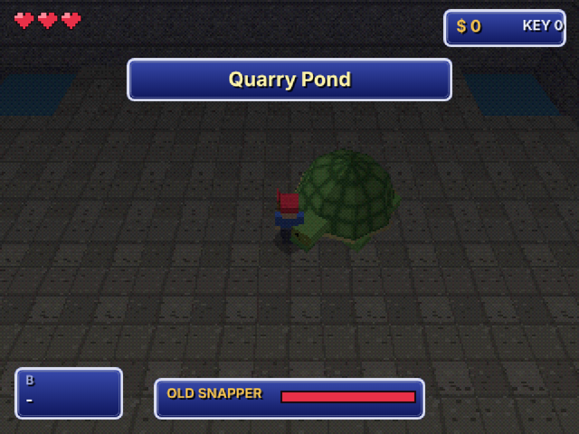
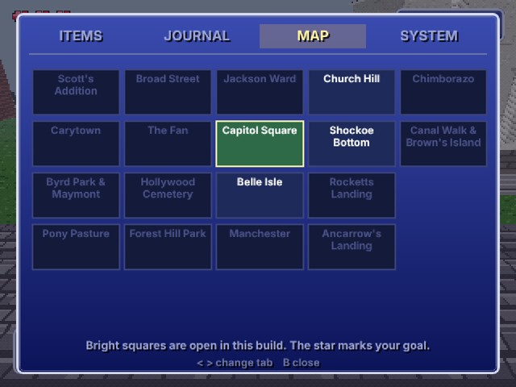
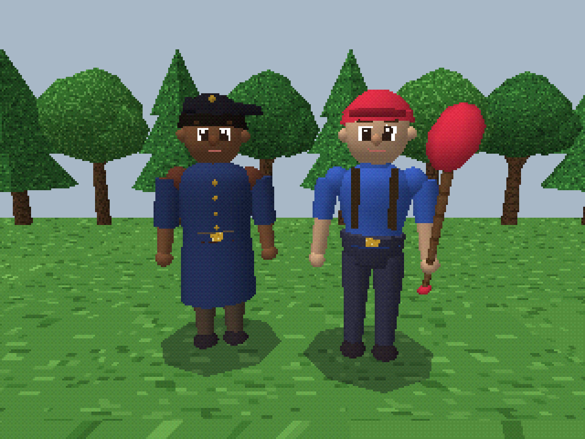

# River City Quest 3D

**Play it: https://doodersrage.github.io/river-city-quest-3d/**

A low-poly, PS1-style take on [River City Quest](https://github.com/doodersrage/river-city-quest), the Zelda-like adventure set in Richmond, Virginia. A cold fog has rolled up off the James and the gas lamps are going dark. The archivist at the Capitol needs four keystones to open the old Church Hill Tunnel, and the first one is somewhere in the Belle Isle Quarry.

This first build is a playable slice: four neighborhoods, the quarry dungeon and its boss, and the start of the story.

| | |
|---|---|
|  |  |
|  |  |
|  |  |
|  |  |
|  |  |

## What's in it

- **Four neighborhoods in 3D:** Capitol Square, Shockoe Bottom, Church Hill and Belle Isle, built tile for tile from the 2D game's maps. Brick rows become buildings, trees and rocks stand up, the James runs between them, and you walk from one neighborhood into the next.
- **Detailed streets:** brick buildings with window sills and lintels, cornices with brackets, chimneys, striped shop awnings, rowhouse doors with stoops and cast-iron balconies, plus fire hydrants, trash cans, newspaper boxes, mailboxes, street signs and parked cars. Sidewalks have curbs and gutters, grass has tufts and worn patches, and flower beds bloom.
- **A living river and town:** rocks break the surface of the James with foam around them and along the banks, the water rolls, and at night the moon and the gas lamps shimmer on it. Trees sway, people shift their weight and nod while they talk, and pigeons scatter when you walk up.
- **Landmarks:** the Capitol's portico, the old bell tower, Main Street Station's clock tower, the 17th Street Market shed, St. John's Church and the power plant ruins on Belle Isle.
- **The Belle Isle Quarry:** four rooms with a small key, a locked door, blasting powder, a cracked wall and Old Snapper, a giant turtle you have to trick into charging a wall.
- **A third-person camera** that trails behind you like late-90s 3D adventures. Swing it with a drag, the right stick or Q and E. In the quarry it holds a fixed angle over each room.
- **People and stories:** everyone from the 2D slice is here with their lines, and every historical marker goes into your journal. People are rounded low-poly figures with faces, hair and hats, and dress for their part: the archivist's glasses and book, the reenactor's tricorn and coat, the lamplighter's pole, the kayaker's helmet and life vest.
- **Four neighborhood challenges:** light Church Hill's gas lamps, clear the market rats, clean up Belle Isle and take the history quiz.
- **Day and night:** a full day passes about every ten minutes. At night the fog closes in, the gas lamps glow, your lantern lights the way and ghosts come out.
- **The PS1 look, done by hand:** everything renders at 320x240, vertices snap to that pixel grid so they wobble, textures warp without perspective correction, colors are dithered down to 15 bits, and fog hides the short draw distance. There's no 3D library: it's plain WebGL 2.
- **Sound:** synthesized effects and soft looping music washed in reverb.
- **Phones:** a touch stick, A, B, ITEM and MENU buttons, and drag on the right side of the screen to turn the camera. Portrait and landscape both work.
- **Saves** to your browser, and the game works offline once it's loaded.

## Controls

| | Keyboard | Gamepad | Touch |
|---|---|---|---|
| Move | WASD or arrows | Left stick | Stick |
| Talk, read, open, swing | J, Space or Z | A | A |
| Use item | K, Shift or X | B / X | B |
| Switch item | L, Tab or C | Y / RB | ITEM |
| Camera | Q and E | Right stick, LT / RT | Drag on the right |
| Menu | Enter or Esc | Start | MENU |

## How it's built

Plain JavaScript and WebGL 2, no build step and no libraries. The scripts load in order from `index.html` and share one global scope.

- `js/data.js`: the places, people, stories and quarry rooms, imported from the 2D game by `tools/import-2d.js`. Don't edit it by hand.
- `js/mesh.js`: geometry helpers and the texture atlas layout
- `js/tex.js`: the 32x32 textures, painted in code at startup
- `js/level.js`: turns a 2D tile map into a 3D place
- `js/models.js`: low-poly people, creatures and props
- `js/game.js`: the game itself, with no drawing in it
- `js/render.js`: the PS1-style WebGL renderer
- `js/hud.js`: hearts, dialog windows, the pause menu and the title
- `js/input.js`, `js/audio.js`, `js/main.js`: controls, sound and the frame loop

To pull fresh data from the 2D game, check both repos out side by side and run:

```
node tools/import-2d.js ../river-city-quest
```

## Tests

```
node tests/run.js
```

The tests load the game into Node without a screen. `playthrough.test.js` has a bot play the whole slice: get the lantern, walk to Belle Isle, clear the quarry, unlock the door, blow the wall, beat Old Snapper and bring the keystone home. `features.test.js` covers markers, all four challenges, bushes, nighttime, dying and the menu. GitHub Actions runs them on every push.
